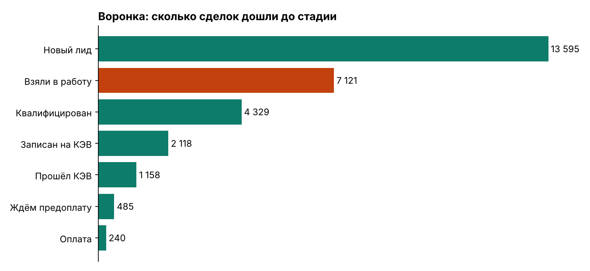
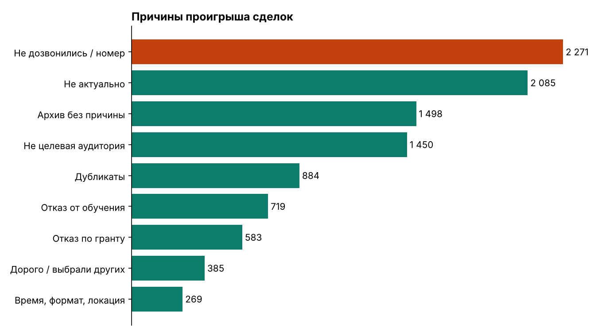
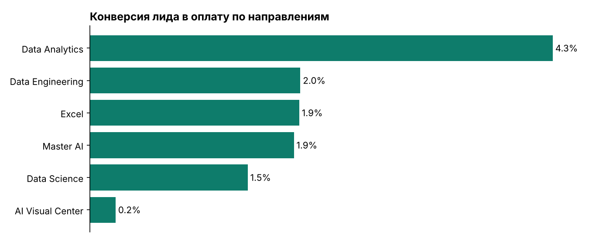
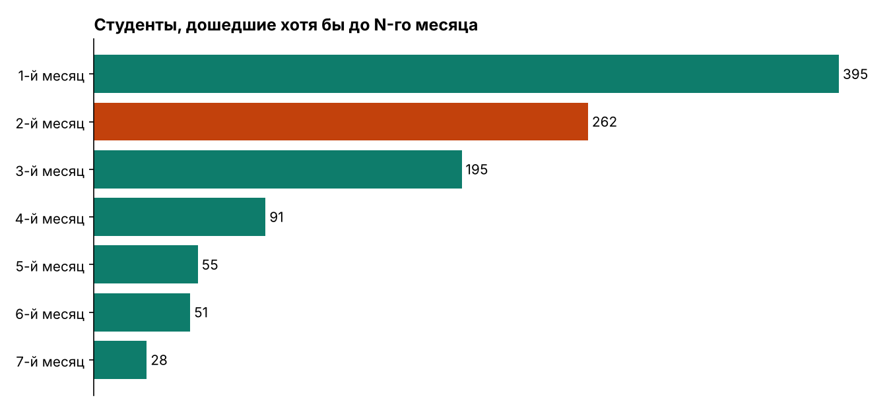

# CRM-аналитика продаж EdTech-школы

**Нурболот Дженишбеков · Data Analyst** · [Портфолио (сайт)](https://dzenisbekovnurbolot.github.io/edtech-crm-sales-analytics/) · [LinkedIn](https://www.linkedin.com/in/%D0%BD%D1%83%D1%80%D0%B1%D0%BE%D0%BB%D0%BE%D1%82-%D0%B4%D0%B6%D0%B5%D0%BD%D0%B8%D1%88%D0%B1%D0%B5%D0%BA%D0%BE%D0%B2-32a5533a5/) · dzenisbekovnurbolot@gmail.com

Анализ воронки продаж и удержания студентов по данным Bitrix24 из хранилища (DDS-слой): где теряются лиды, какие направления лучше продаются, на каком месяце обучения уходят студенты и насколько можно доверять данным CRM.

| Данные | Объём |
|---|---|
| Сделки | 17 661 |
| События смены стадий | 54 855 |
| Интервалы «стадия → длительность» | ~100 тыс. |
| Период | январь – август 2026 |

**Стек:** SQL (PostgreSQL) · Python (pandas, matplotlib) · Tableau · Bitrix24

## Ключевые выводы

1. **48% лидов не берут в работу.** До стадии «Взял в работу» дошли 7 121 из 13 595 сделок; ещё 2 271 проиграна с причиной «не дозвонились». → SLA на первый контакт и автосообщение в WhatsApp.
2. **Консультация (КЭВ) — главный рычаг.** После КЭВ оплачивает 21%, после стадии «Ждём предоплату» — 49%.
3. **Data Analytics конвертируется в 3 раза лучше Data Science:** 4,3% против 1,5% при сопоставимом потоке (~2 300 лидов).
4. **Отвал студентов между 1-м и 2-м месяцем:** до второго месяца доходят 66%.
5. **Атрибуция сломана:** у 51% лидов и 91% оплат источник «Не указано», у 12,7% сделок отрицательная длительность цикла (дата закрытия без времени). → Обязательные поля в CRM.

## Графики






## Структура

```
analysis/metrics.py      расчёт всех метрик и графиков из выгрузки
sql/                     те же расчёты на SQL для DDS-слоя PostgreSQL
data/aggregates/         итоговые агрегаты (CSV)
images/                  графики для README
tableau/                 CRM-дашборд Tableau (12 листов: Win Rate, выручка, цикл, воронка, менеджеры, источники)
index.html               сайт-портфолио (GitHub Pages)
```

## Как воспроизвести

```bash
pip install -r requirements.txt
python analysis/metrics.py data/Bitrix24_DDS_dannye.xlsx
```

Сырые данные компании в репозиторий не входят: опубликованы только агрегаты. Имена менеджеров обезличены, выручка и средний чек не публикуются.

## Методика

- Воронка считается **по факту прохождения стадий** из истории событий: сделка «дошла до стадии», если в истории есть эта стадия или любая следующая. Подсчёт по текущему статусу занижает верхние этапы.
- 30+ стадий закрытия сгруппированы в 9 причин отказа.
- Удержание: «дошёл хотя бы до N-го месяца». Программы разной длины, а данные обрываются в августе, поэтому поздние месяцы занижены (цензурирование).
